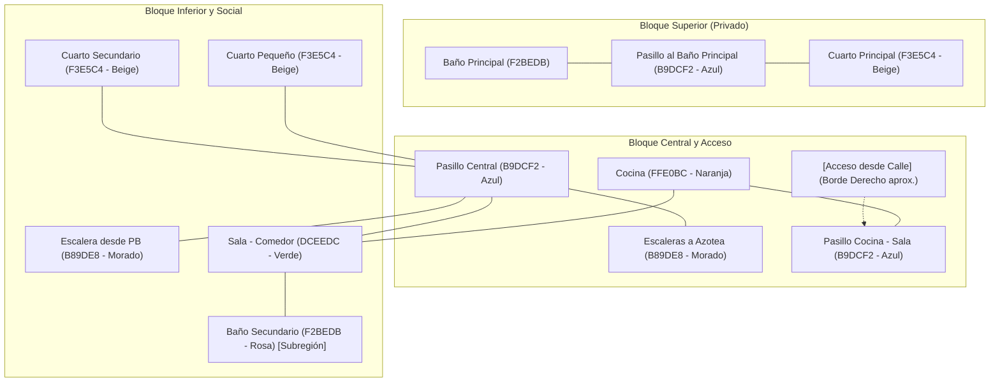
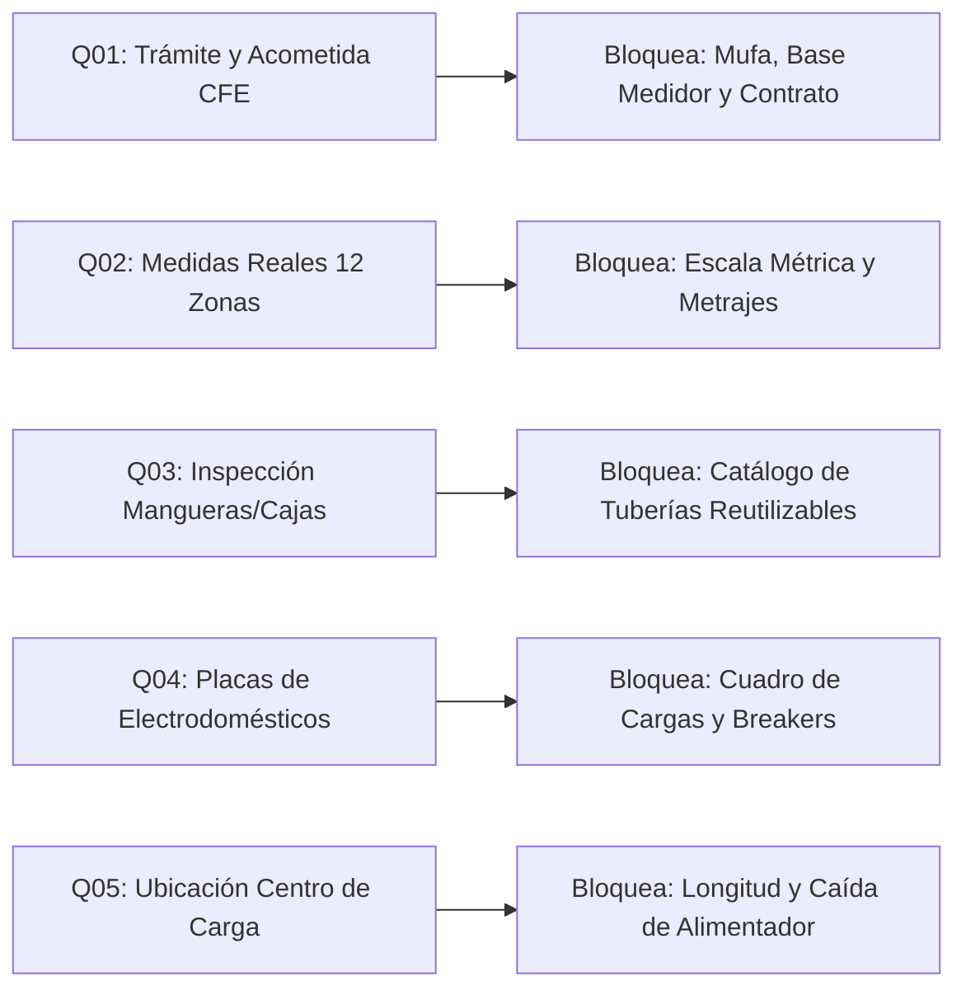

# Diagnóstico Integral de Datos Faltantes y Estado de Obra
**Proyecto:** Instalación Eléctrica Residencial Independiente — Planta Alta  
**Ubicación:** Ciudad de México (CDMX)  
**Fecha de corte:** Noviembre 2026 | **Versión:** 3.0 (Estructura Validada)  
**Normativa de referencia:** NOM-001-SEDE-2012 / CFE-EM-BT102 / CFE-GIC00-05  

---

## 1. Resumen Ejecutivo y Condición de Anteproyecto

El proyecto contempla una **instalación eléctrica completamente nueva, independiente y aislada** para el piso de planta alta (habitado por 2 personas), ubicado dentro de un inmueble con suministro previo. 

> [!IMPORTANT]
> **REGLA RECTORA DE ANTEPROYECTO:**
> Este documento y la aplicación local constituyen un **anteproyecto técnico y herramienta de modelado**. Ningún cálculo de calibres, selección de interruptores, recorrido de tuberías o presupuesto de compras se considerará **DEFINITIVO O APROBADO** mientras no se completen las mediciones físicas en obra, la inspección de preinstalaciones por un electricista calificado y la validación de factibilidad por parte de CFE.

---

## 2. Jerarquía Documental Autorizada

Para evitar errores de interpretación geométrica o espacial, se establece la siguiente prelación estricta:

1. **`fuentes/01_ESTRUCTURA_VALIDADA_POR_USUARIO.png`:** Única fuente autorizada de organización topológica y distribución relativa de la vivienda.
2. **`fuentes/07_ACLARACION_AZUL_PASILLO_MORADO_ESCALERAS.png`:** Regla cromática confirmada: **AZUL = Pasillos de circulación**, **MORADO = Escaleras**. Ningún texto de croquis altera esta distinción.
3. **`modelo/PLANO_BASE_CON_ACCESO_NO_ESCALA.svg` y `modelo/MODELO_ARQUITECTONICO_ESQUEMATICO.json`:** Digitalización esquemática vectorial de las 12 zonas oficiales. Las unidades son píxeles esquemáticos, **NO representan metros ni escala métrica**.
4. **`fuentes/02_CROQUIS_CON_MEDIDAS.jpg` y `datos/COTAS_PARCIALES.csv`:** Cotas parciales observadas (M01 a M11). Su aplicación a segmentos métricos está sujeta a verificación en sitio.
5. **`fuentes/04_LEVANTAMIENTO_ELECTRICO_A.jpg` a `06_CONTEO_Y_OTROS_CROQUIS.jpg`:** Registros de ubicaciones de levantamiento (A1–A15, C1–C18, P1–P7). Son puntos de inspección, **no circuitos ni dispositivos montados**.
6. **`fuentes/08_PRIMER_CROQUIS_DIGITAL.jpg`:** Antecedente digital; únicamente como apoyo histórico, no como geometría vigente.

---

## 3. Topología Arquitectónica Validada (12 Zonas Oficiales)

La vivienda se compone de 12 zonas funcionales estructuradas de la siguiente manera:

### Características Críticas de la Distribución:
1. **Acceso desde la Calle:** Se ubica de forma aproximada sobre el **borde derecho del esquema**, a la altura del pasillo lateral entre cocina y sala-comedor. *(No es un vano medido; la posición exacta y cota de nivel deben validarse en fachada).*
2. **Doble Núcleo de Escaleras:** Claramente diferenciadas:
   - Escalera desde Planta Baja al Primer Piso (llegada de acceso y ruta probable del alimentador).
   - Escalera independiente hacia la azotea / nivel superior.
3. **Subregión de Baño Secundario:** El baño secundario se encuentra ubicado en la esquina inferior izquierda del polígono general de la sala. Para el cálculo de áreas y demanda de alumbrado (NOM Art. 220-12), **se debe sustraer su superficie del área de sala** para evitar doble contabilización.
4. **Sin Orientación Geográfica Inventada:** El lado derecho del plano es el borde derecho de la imagen, no equivale al Este geográfico.

---

## 4. Estado Real de los Componentes de la Instalación (`ESTADO_REAL_INSTALACION.csv`)

| ID | Componente | ¿Existe Físicamente? | Estado Técnico | Implicación de Obra y Compras |
| :--- | :--- | :---: | :--- | :--- |
| **E01** | Canalizaciones / Mangueras | **SÍ** | `EXISTENTES_SIN_VERIFICAR` | Existen mangueras empotradas en losas y muros. **NO comprar poliducto nuevo** hasta inspeccionar con sonda guía su continuidad, diámetro y si están libres de obstrucciones. |
| **E02** | Cajas y chalupas empotradas | **SÍ** | `EXISTENTES_SIN_VERIFICAR` | Chalupas metálicas/plásticas empotradas en muros. Se debe registrar cantidad física exacta, dimensiones (chalupa 2x4, caja 4x4, octagonal) y estado de oxidación/fijación. |
| **E03** | Cableado interior nuevo | **NO** | `NO_INSTALADO` | **Cero conductores instalados** del nuevo sistema dentro de las mangueras. Prohibido comprar hasta contar con el cuadro de cargas y longitudes reales validadas. |
| **E04** | Contactos montados | **NO** | `NO_INSTALADOS` | No hay mecanismos ni placas montadas. Su compra está sujeta a definir los circuitos obligatorios con protección diferencial GFCI (NOM Art. 210-8). |
| **E05** | Apagadores montados | **DESCONOCIDO** | `POR_VERIFICAR` | Los códigos A1 a A15 corresponden a puntos marcados en croquis, no a interruptores físicos instalados. |
| **E06** | Centro de carga del piso | **NO** | `NO_INSTALADO` | No existe tablero de distribución propio para este piso. Ubicación física, capacidad de barras (mínimo 100A) y número de espacios (mínimo 8 espacios QO) por calcular. |
| **E07** | Segundo medidor CFE | **NO** | `NO_INSTALADO` | **CFE instala y suministra el medidor**. Está terminantemente prohibido comprar un medidor en el mercado particular. |
| **E08** | Contrato CFE independiente | **NO** | `PENDIENTE_TRAMITE` | Requiere validar factibilidad técnica ante CFE para segundo servicio aéreo en el mismo predio con acometida y cuenta independientes. |
| **E09** | Puesta a tierra y protecciones | **DESCONOCIDO** | `POR_PROYECTAR` | No se debe compartir ni puentear la tierra de la instalación de planta baja. Requiere electrodo de tierra dedicado (varilla Copperweld 5/8" × 3.0 m) y conductor desnudo 8 AWG. |
| **E10** | Cable aportado por el padre | **DESCONOCIDO** | `INVENTARIO_POTENCIAL_NO_APROBADO` | Rollo de cable existente sin datos técnicos validados. **Prohibido descontarlo del presupuesto** hasta que un electricista certifique cobre electrolítico (no CCA), aislamiento THW-2-LS 90°C y prueba de aislamiento megger. |

---

## 5. Matriz de Bloqueos de Ingeniería: Preguntas Prioritarias (`PREGUNTAS_PRIORITARIAS.csv`)

### Prioridad ALTA (Bloqueo Crítico de Diseño y Presupuesto)

#### 🔴 Q01: Suministro, Acometida y Segundo Medidor CFE
- **Módulo Bloqueado:** Acometida exterior, alimentador general y base de medición.
- **Datos Requeridos:**
  1. Distancia en metros desde el poste de distribución aérea más cercano hasta la fachada de la vivienda.
  2. Ubicación exacta del medidor existente de planta baja y espacio disponible junto a él (mínimo 20 cm libres para instalar la segunda base redonda de 5 terminales).
  3. Confirmación formal con CFE de la factibilidad técnica para otorgar un **segundo contrato bifásico 2F-3H (120/240 V)** en el mismo predio catastral.
  4. Altura disponible en fachada exterior para colocar la mufa de 1 1/4" a no menos de 4.80 m sobre el nivel de banqueta (especificación CFE-EM-BT102).

#### 🔴 Q02: Geometría Arquitectónica Completa y Alturas de Losa
- **Módulo Bloqueado:** Escala del plano 2D, cálculo de áreas interiores y longitud de conductores.
- **Datos Requeridos:**
  1. Ancho y largo interiores en metros de cada una de las 12 zonas validadas.
  2. Alturas de entrepiso (distancia de piso terminado a losa de techo) en todas las zonas y descanso de escaleras.
  3. Espesor de muros perimetrales e interiores (mampostería vs tabique).
  4. Validación de los extremos reales de las cotas M01 a M11 (`COTAS_PARCIALES.csv`).
  5. Cierre geométrico y comunicación de accesos del cuarto secundario y cuarto pequeño en el bloque izquierdo.

#### 🔴 Q03: Inspección Física de Mangueras y Cajas Empotradas
- **Módulo Bloqueado:** Cuantificación de canalizaciones, rutas de cableado y demoliciones/ranurado.
- **Datos Requeridos:**
  1. Prueba de sondeo con guía plástica/metálica en cada una de las mangueras empotradas para validar que no estén aplastadas o tapadas con mezcla de concreto.
  2. Diámetro interior real de cada ducto existente (1/2" o 3/4").
  3. Trayectoria de origen y destino de cada canalización (especialmente entre cocina, baños y pasillo central).
  4. Identificación de la caja vertebral empotrada en pasillo ("Caja" rotulada en croquis) para evaluar si es idónea como nodo de distribución.

#### 🔴 Q04: Inventario Real de Cargas y Placas Eléctricas
- **Módulo Bloqueado:** Cuadro de cargas NOM Art. 220, cálculo de corriente por fase, calibre del alimentador y protecciones termomagnéticas.
- **Datos Requeridos:**
  1. Fotografías nítidas de las placas de especificaciones técnicas (Watts, Amperes, Voltaje, Frecuencia) de:
     - Refrigerador doméstico.
     - Horno de microondas.
     - Lavadora automática.
     - Estufa / parrilla (gas con encendido eléctrico vs parrilla de inducción eléctrica).
     - Equipos de cómputo, pantallas y entretenimiento.
  2. Confirmación expresa: ¿Se instalará calentador de agua eléctrico (boiler instantáneo/tanque), secadora eléctrica de ropa, equipo de aire acondicionado o bomba de agua? *(Si no se confirman, se mantienen como cargas opcionales futuras).*

#### 🔴 Q05: Sitio Físico para el Centro de Carga y Ruta del Alimentador
- **Módulo Bloqueado:** Dimensionamiento del alimentador general, caída de tensión y tablero Square D.
- **Datos Requeridos:**
  1. Definición del muro donde se empotrará el nuevo centro de carga en planta alta (debe ser un área de libre acceso, iluminada, fuera de baños y clósets, preferentemente en pasillo central a 1.70 m sobre NPT al centro del interruptor más alto).
  2. Ruta física real para la tubería conduit metálica de 1" desde la base del segundo medidor exterior en banqueta hasta el nuevo centro de carga en planta alta (trayectoria a través del cubo de escalera desde planta baja).
  3. Longitud real medida en metros de dicha trayectoria (incluyendo tramos verticales y horizontales).

---

### Prioridad MEDIA (Ajuste de Confort, Acabados y BOM)

#### 🟡 Q06: Puertas, Ventanas y Ergonomía de Apagadores
- **Módulo Bloqueado:** Ubicación precisa de apagadores (lado de la cerradura) y vanos arquitectónicos.
- **Datos Requeridos:**
  - Sentido de abatimiento (apertura hacia adentro/afuera, izquierda/derecha) de las puertas P1 a P7.
  - Altura de antepechos y dimensiones finales de ventanas V1 y V2.

#### 🟡 Q07: Verificación del Cable Reutilizable del Padre
- **Módulo Bloqueado:** Descuento en la partida de conductores del presupuesto.
- **Datos Requeridos:**
  - Foto de las marcas impresas sobre el aislamiento exterior: calibre (AWG/kcmil o mm²), tipo de aislamiento (THW-2, THHN, etc.), tensión máxima (600 V) y certificación (NOM-ANCE).
  - Verificación metalúrgica: ¿Es cobre electrolítico 100% puro o aluminio cobrizado (CCA)? *(El CCA está prohibido por NOM-001 en instalaciones residenciales por riesgo de incendio en bornes de apriete).*
  - Prueba de resistencia de aislamiento con megóhmetro (mínimo 50 MΩ a 500 V de corriente directa).

#### 🟡 Q08: Salidas Eléctricas Deseadas vs Levantamiento
- **Módulo Bloqueado:** Catálogo de mecanismos y placas decorativas.
- **Datos Requeridos:**
  - Revisar si los 18 contactos y 15 apagadores levantados en croquis cubren las necesidades de mobiliario real de las dos usuarias, o si se requiere añadir salidas especiales (ej. contacto en barra desayunadora, espejo de tocador o apagadores de 3 vías/escalera adicionales).

---

## 6. Inventario de Cotas Parciales Registradas (`COTAS_PARCIALES.csv`)

| ID | Valor (m) | Descripción según Croquis | Fuente Original | Estatus de Validación |
| :---: | :---: | :--- | :--- | :--- |
| **M01** | 7.43 m | Cota longitudinal a la derecha en croquis «Cocina, pasillo y sala» | `02_CROQUIS_CON_MEDIDAS.jpg` | Pendiente verificar extremos |
| **M02** | 4.06 m | Cota horizontal inferior en croquis «Cocina, pasillo y sala» | `02_CROQUIS_CON_MEDIDAS.jpg` | Pendiente verificar extremos |
| **M03** | 3.55 m | Cota horizontal rotulada «Cuarto», sobre cocina | `02_CROQUIS_CON_MEDIDAS.jpg` | Asociación exacta por verificar |
| **M04** | 2.27 m | Cota de costado izquierdo en «Baño y cuarto principal» | `02_CROQUIS_CON_MEDIDAS.jpg` | Asociación exacta por verificar |
| **M05** | 3.90 m | Cota vertical exterior derecha en «Baño y cuarto principal» | `02_CROQUIS_CON_MEDIDAS.jpg` | Lectura y extremos por verificar |
| **M06** | 1.50 m | Ancho de ventana superior derecha | `02_CROQUIS_CON_MEDIDAS.jpg` | Ventana específica por verificar |
| **M07** | 1.17 m | Altura de ventana superior derecha | `02_CROQUIS_CON_MEDIDAS.jpg` | Ventana específica por verificar |
| **M08** | 1.50 m | Ancho de ventana inferior derecha | `02_CROQUIS_CON_MEDIDAS.jpg` | Ventana específica por verificar |
| **M09** | 1.14 m | Altura de ventana inferior derecha | `02_CROQUIS_CON_MEDIDAS.jpg` | Ventana específica por verificar |
| **M10** | 2.20 m | Cota vertical de clóset de cuarto principal | `02_CROQUIS_CON_MEDIDAS.jpg` | Cierre de geometría por verificar |
| **M11** | 0.65 m | Cota de profundidad de clóset principal | `02_CROQUIS_CON_MEDIDAS.jpg` | Cierre de geometría por verificar |

---

## 7. Protocolo de Inspección en Sitio y Medidas de Seguridad

> [!CAUTION]
> **ACTIVIDADES PROHIBIDAS A LAS USUARIAS (RIESGO ELÉCTRICO CRÍTICO):**
> 1. Queda estrictamente prohibido abrir tapas, intervenir o retirar sellos del medidor existente de planta baja o de la base de medición de CFE.
> 2. Queda prohibido manipular, cortar o pelar conductores conectados a la red aérea o al poste.
> 3. No realizar conexiones provisionales ("diablitos" o puentes) entre el suministro actual y las mangueras del nuevo piso.
> 4. Toda medición de tensión en bornes vivos o manipulación de acometidas debe ser realizada exclusivamente por personal certificado o cuadrillas oficiales de CFE.

### Tareas Seguras Autorizadas para las Usuarias:
- Fotografiar fachadas, postes desde la banqueta y placas de electrodomésticos.
- Medir con flexómetro las longitudes interiores de muros y alturas de techos.
- Registrar con cinta métrica el sentido de apertura de las puertas.
- Acompañar al electricista en la prueba de sondeo de mangueras empotradas.
