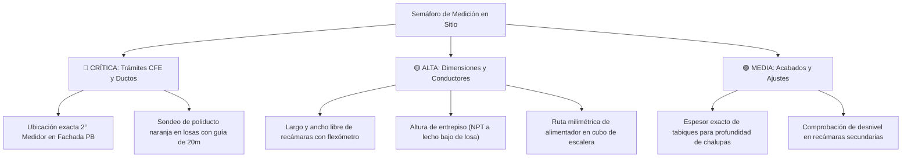
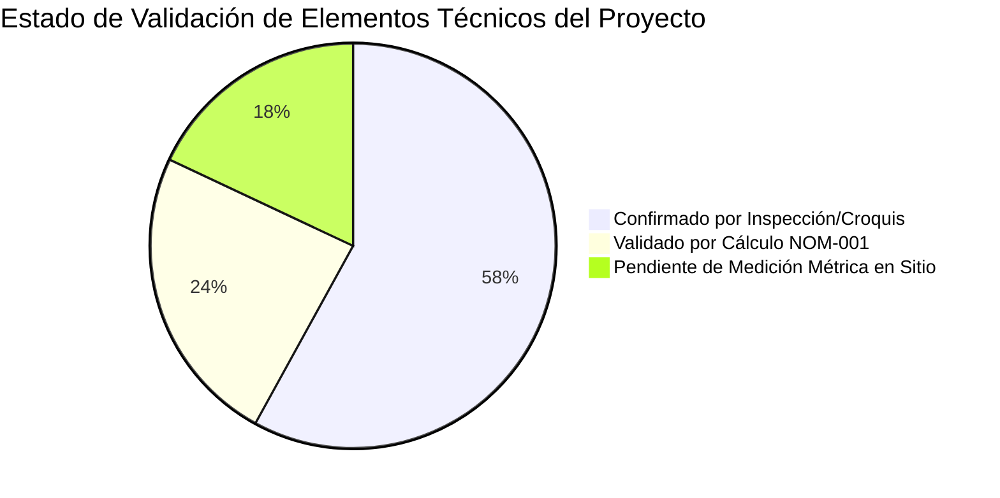

# Inventario Técnico del Levantamiento Arquitectónico y Eléctrico en Sitio
## Integración de Croquis Físicos y Diagnóstico de Concordancia Normativa NOM-001-SEDE-2012
**Proyecto:** Instalación Eléctrica Residencial Independiente (Planta Alta)  
**Ubicación:** Ciudad de México (CDMX), México  
**Fecha de Levantamiento:** Noviembre 2026  
**Documentación de Campo:** Cuaderno de notas y croquis acotados (Fotografías 52, 53 y 54)  
**Herramienta de Modelado:** [VoltHome CDMX (http://localhost:5173)](http://localhost:5173)

---

## 1. Resumen Ejecutivo del Levantamiento

A partir de la inspección física en sitio documentada en tres fotografías adicionales de libreta de campo, se transcribió e integró al modelo de datos arquitectónico y eléctrico el siguiente inventario de elementos físicos:

- **15 Apagadores (A1 a A15):** Identificadores de ubicación de control de iluminación (tanto sencillos como combinaciones conmutables de 3 vías en escalera y accesos).
- **18 Contactos Eléctricos (C1 a C18):** Identificadores de ubicación de salidas de tomacorriente dúplex con puesta a tierra.
- **7 Puertas Registradas con Medidas (P1 a P7):** 5 puertas de recámaras/pasos normales y 2 puertas de baños.
- **2 Ventanas con Cotas de Taller (V1 y V2):** Ubicadas en el muro exterior de Baño 1.
- **3 Clósets Empotrados con Medidas Reales:** Closet 1 (Recámara Sec 1), Closet 2 (Recámara Sec 2) y Closet 3 (Cuarto Principal).
- **1 Registro en Muro ("Caja"):** Ubicado físicamente en el muro poniente del pasillo distribuidor central, nodo idóneo para el nuevo centro de carga de distribución.

> [!IMPORTANT]
> **REGLA FUNDAMENTAL DE INGENIERÍA ELÉCTRICA:**
> Los identificadores `A1 a A15` y `C1 a C18` son **códigos físicos de levantamiento en obra**, **NO números de circuitos derivados**. No deben confundirse las salidas de contacto (como `C1`) con circuitos de fuerza (como `Circuito C2`).
> Asimismo, los 18 contactos registrados no deben considerarse automáticamente suficientes ni definitivos: la [NOM-001-SEDE-2012](file:///c:/Users/rodri/Downloads/Casa/memoria_tecnica_de_calculo.md) exige circuitos adicionales independientes para pequeños enseres en cocina (Art. 210-52(B)) y protección obligatoria con interruptor de falla a tierra (GFCI Clase A) en baños, cocina, exteriores y áreas de lavado (Art. 210-8).

---

## 2. Reconstrucción Arquitectónica e Interconexión de Espacios

### Análisis Espacial Conjunto de los Tres Croquis:
1. **Croquis "Parte (1)" (Foto 53):**
   - **Cuarto Principal (Suite):** Espacio amplio orientado al norte, delimitado al poniente por Baño 1 y Closet 3 ($2.21 \times 2.50\text{ m}$). Contiene los contactos `C1`, `C2`, `C3`, los apagadores `A2` (junto al baño) y `A3` (junto al acceso principal por puerta `P2` de $0.95 \times 2.21\text{ m}$).
   - **Baño 1 (Suite Principal):** Acceso privado y exclusivo desde el Cuarto Principal mediante puerta `P1` ($0.70 \times 2.00\text{ m}$). Cuenta con apagador `A1` y dos ventanas altas de ventilación en muro exterior: `V1` ($0.60 \times 0.34\text{ m}$) y `V2` ($0.63 \times 0.31\text{ m}$).
   - **Pasillo Distribuidor Central:** Eje vertebral de circulación. Aloja el registro embutido en muro denominado **"Caja"**, el apagador `A6` inmediatamente sobre la caja, el contacto `C11`, y los controles `A4`, `A5` y contactos `C4`, `C5`, `C6`. Conecta con la Suite Principal, Baño 2, Estancia y el Cubo de Escalera.
   - **Baño 2 (Secundario / Visitas):** Ubicado en el costado poniente del pasillo, con acceso por puerta `P3` ($0.70 \times 1.93\text{ m}$, dintel rebajado). Contiene el apagador `A7` y el contacto `C7` junto al lavabo (obligatorio GFCI).
   - **Sala / Estancia Sur:** Zona social amplia delimitada en su muro sur por una alineación horizontal de tres contactos: `C8`, `C9` y `C10` (correspondientes al centro de entretenimiento y TV visible en las fotografías 24 y 25).
   - **Cocina (Integrada con base en fotos 18 a 23):** Espacio contiguo a la estancia social con barra desayunadora marmoleada de $2.00\text{ m}$ y arco de medio punto.

2. **Croquis "Cuartos secundarios" (Foto 54, Bloque Superior):**
   - **Cubo de Escaleras:** Tramo con peldaños compensados en abanico y tiro vertical achurado, equipado con el apagador `A15` en descanso intermedio.
   - **Puerta `P4` ($0.94 \times 2.21\text{ m}$):** Vano de acceso desde el distribuidor de escalera hacia la zona de cuartos secundarios.
   - **Recámara Secundaria 1:** Habitación equipada con `A8` (ingreso), `C12` (muro norte), `A10` (muro oriente), `A9` (muro divisorio) y el `Closet 1` ($1.74 \times 2.51\text{ m}$).
   - **Puerta Interior `P5` ($0.90 \times 2.21\text{ m}$):** Comunica directamente en suite la Recámara Secundaria 1 con la Recámara Secundaria 2.
   - **Recámara Secundaria 2:** Habitación comunicada a través de `P5`, con `Closet 2` ($1.73 \times 2.50\text{ m}$, adosado espalda con espalda con Closet 1), apagador `A11` y contactos `C13`, `C14` y `C15`.

3. **Croquis "Arriba" (Foto 54, Bloque Inferior):**
   - **Diagnóstico de Conexión Vertical:** La leyenda "Arriba" no debe interpretarse a la ligera como una vivienda independiente. Representa la **llegada superior de la escalera al nivel de azotea / terraza**.
   - **Descansillo Superior:** Desembarque de escalera protegido por muros, con apagador de escalera `A12` (3 vías con A15), apagador `A13` junto a la puerta exterior `P6` ($0.865 \times 2.15\text{ m}$), y contactos `C16` y `C17`.
   - **Cuarto Superior de Azotea / Lavado:** Espacio techado independiente accesible cruzando el descansillo/terraza a través de la puerta alta `P7` ($0.90 \times 2.33\text{ m}$, típica de cancelería o herrería exterior). Contiene el apagador `A14` y la toma de fuerza `C18`, idónea para centro de lavado o planchado bajo protección GFCI.

---

## 3. Tabla de los 18 Contactos Eléctricos (C1 a C18)

| Código | Espacio / Habitación | Croquis de Origen | Referencia Física en Croquis | Circuito Propuesto (NOM) | Tensión y Protección | Evaluación Normativa NOM-001-SEDE-2012 |
| :---: | :--- | :---: | :--- | :---: | :---: | :--- |
| **C1** | Cuarto Principal | Parte (1) | Muro interior adosado a Closet 3 | Circuito C2 | 120V / 15A Dúplex | Contacto general de recámara. Cumple Art. 210-52(A). |
| **C2** | Cuarto Principal | Parte (1) | Muro norte exterior, cuadrante izquierdo | Circuito C2 | 120V / 15A Dúplex | Contacto para buró / lámpara de noche. Art. 210-52(A). |
| **C3** | Cuarto Principal | Parte (1) | Muro norte exterior, cuadrante derecho | Circuito C2 | 120V / 15A Dúplex | Salida general para tocador o TV en recámara. |
| **C4** | Pasillo Central | Parte (1) | Muro norte bajo tabique de suite | Circuito C2 | 120V / 15A Dúplex | Contacto obligatorio en pasillos > 3.0 m (Art. 210-52(H)). |
| **C5** | Pasillo Central | Parte (1) | Muro distribuidor junto a C4 | Circuito C2 | 120V / 15A Dúplex | Toma auxiliar para aspiradora o servicio. |
| **C6** | Pasillo Central | Parte (1) | Muro divisorio intermedio horizontal | Circuito C2 | 120V / 15A Dúplex | Contacto de paso en circulación central. |
| **C7** | Baño 2 (Secundario) | Parte (1) | Muro interior junto a puerta P3 y lavabo | **Circuito C5** | **120V / 20A GFCI** | **OBLIGATORIO GFCI Clase A** (Art. 210-8(A)(1)). A menos de 90 cm de tarja de lavabo. |
| **C8** | Sala / Estancia Sur | Parte (1) | Muro sur exterior, extremo izquierdo | Circuito C2 | 120V / 15A Dúplex | Contacto de pared para luminaria de piso o equipo de audio. |
| **C9** | Sala / Estancia Sur | Parte (1) | Muro sur exterior, centro (chalupa gemela) | Circuito C2 | 120V / 15A Dúplex | Salida multimedia TV/Internet (coincide con fotos 24-25). |
| **C10** | Sala / Estancia Sur | Parte (1) | Muro sur exterior, extremo derecho | Circuito C2 | 120V / 15A Dúplex | Contacto perimetral conforme a espaciamiento Art. 210-52. |
| **C11** | Pasillo Central | Parte (1) | Muro poniente frente a acceso Baño 2 | Circuito C2 | 120V / 15A Dúplex | Toma de servicio general de circulación. |
| **C12** | Recámara Sec 1 | Cuartos sec. | Muro norte de Recámara 1 | Circuito C2 | 120V / 15A Dúplex | Salida de pared para estudio / escritorio. |
| **C13** | Recámara Sec 2 | Cuartos sec. | Muro lateral derecho (oriente) | Circuito C2 | 120V / 15A Dúplex | Contacto general de recámara. Art. 210-52(A). |
| **C14** | Recámara Sec 2 | Cuartos sec. | Muro sur, cuadrante derecho | Circuito C2 | 120V / 15A Dúplex | Salida para buró o cabecera de cama. |
| **C15** | Recámara Sec 2 | Cuartos sec. | Muro sur, cuadrante izquierdo | Circuito C2 | 120V / 15A Dúplex | Salida general para entretenimiento / lámpara. |
| **C16** | Escalera "Arriba" | Arriba | Muro sur de descansillo superior | Circuito C2 | 120V / 15A Dúplex | Salida de servicio para mantenimiento de azotea. |
| **C17** | Escalera "Arriba" | Arriba | Muro derecho junto a puerta P6 | Circuito C2 | 120V / 15A Dúplex | Salida auxiliar para equipo hidroneumático o servicio. |
| **C18** | Cuarto Azotea | Arriba | Muro norte junto a apagador A14 | **Circuito C6** | **120V / 20A GFCI** | **OBLIGATORIO GFCI Clase A** (Art. 210-8(A)(7) y 210-52(F)). Circuito exclusivo de lavado. |

---

## 4. Tabla de los 15 Apagadores (A1 a A15)

| Código | Espacio / Habitación | Croquis de Origen | Ubicación Física y Orientación | Tipo de Control Previsto | Circuito Asociado | Luminaria / Salida Controlada |
| :---: | :--- | :---: | :--- | :---: | :---: | :--- |
| **A1** | Baño 1 (Suite) | Parte (1) | Muro interior junto a jamba P1 | Sencillo unipolar 10A | Circuito C1 | Centro de losa y extractor Baño 1. |
| **A2** | Cuarto Principal | Parte (1) | Muro divisorio junto a P1 y Closet 3 | Sencillo o 3 vías | Circuito C1 | Control de cabecera / luminaria principal suite. |
| **A3** | Cuarto Principal | Parte (1) | Muro sur junto a jamba de puerta P2 | 3 Vías (Conmutable) | Circuito C1 | Conmutador de entrada recámara principal. |
| **A4** | Pasillo Central | Parte (1) | Muro oriente del pasillo | 3 Vías (Conmutable) | Circuito C1 | Control longitudinal de iluminación de pasillo. |
| **A5** | Pasillo Central | Parte (1) | Muro transversal intermedio (flecha sur) | Sencillo unipolar | Circuito C1 | Control de luz en vestíbulo hacia estancia sur. |
| **A6** | Pasillo Central | Parte (1) | Muro poniente directamente sobre Caja | Sencillo o Master | Circuito C1 | Control general pasillo / vestíbulo de acceso. |
| **A7** | Baño 2 (Secundario) | Parte (1) | Muro interior junto a puerta P3 | Sencillo unipolar | Circuito C1 | Centro de luz cenital y espejo LED Baño 2. |
| **A8** | Recámara Sec 1 | Cuartos sec. | Muro poniente junto a puerta P4 | 3 Vías (Conmutable) | Circuito C1 | Control de acceso a recámara secundaria 1. |
| **A9** | Recámara Sec 1 | Cuartos sec. | Muro divisorio sur junto a Closet 1 y P5 | Sencillo unipolar | Circuito C1 | Control auxiliar / luz de closet Recámara 1. |
| **A10** | Recámara Sec 1 | Cuartos sec. | Muro lateral oriente (cabecera) | 3 Vías (Conmutable) | Circuito C1 | Apagador de confort en cabecera de cama. |
| **A11** | Recámara Sec 2 | Cuartos sec. | Muro norte divisorio junto a Closet 2 | Sencillo o 3 vías | Circuito C1 | Control de luz al ingresar desde Recámara 1. |
| **A12** | Escalera "Arriba" | Arriba | Muro superior de escalera | **3 Vías (Escalera)** | Circuito C1 | Conmutador superior de escalera (combina con A15). |
| **A13** | Escalera "Arriba" | Arriba | Muro lateral derecho junto a puerta P6 | Sencillo exterior | Circuito C1 | Control de farol / reflector exterior de azotea. |
| **A14** | Cuarto Azotea | Arriba | Muro oriente interior junto a puerta P7 | Sencillo unipolar | Circuito C1 | Iluminación interior de cuarto de lavado/azotea. |
| **A15** | Cubo Escalera N1 | Cuartos sec. | Muro de descanso en zona de tiro | **3 Vías (Escalera)** | Circuito C1 | Conmutador inferior de escalera (NOM Art. 210-70). |

---

## 5. Inventario Acotado de Puertas, Ventanas y Clósets

### Puertas Físicas (7 Unidades):
| Identificador | Espacio / Conexión | Ancho ($m$) | Alto ($m$) | Superficie Vano ($m^2$) | Clasificación y Características | Sentido de Abatimiento Registrado |
| :---: | :--- | :---: | :---: | :---: | :--- | :--- |
| **P1** | Baño 1 desde Cuarto Principal | **0.70** | **2.00** | 1.40 | Puerta de baño (privada en suite) | Hacia el interior de Baño 1 sobre muro ciego. |
| **P2** | Cuarto Principal desde Distribuidor | **0.95** | **2.21** | 2.10 | Puerta normal (recámara principal) | Hacia el interior de la recámara derecha. |
| **P3** | Baño 2 desde Pasillo Central | **0.70** | **1.93** | 1.35 | Puerta de baño (dintel bajo constructivo) | Hacia el interior de Baño 2 sobre lavabo. |
| **P4** | Recámaras Secundarias desde Descanso | **0.94** | **2.21** | 2.08 | Puerta normal (acceso a zona privada) | Hacia el interior de Recámara Secundaria 1. |
| **P5** | Comunicación Recámara 1 a Recámara 2 | **0.90** | **2.21** | 1.99 | Puerta normal (comunicación en suite) | Hacia el interior de Recámara Secundaria 2. |
| **P6** | Salida de Escalera a Azotea / Terraza | **0.865** | **2.15** | 1.86 | Puerta normal (salida a exterior) | Abatimiento exterior hacia descansillo/terraza. |
| **P7** | Entrada a Cuarto Superior de Azotea | **0.90** | **2.33** | 2.10 | Puerta normal alta (cancelería / herrería) | Hacia el interior del cuarto de azotea. |

### Ventanas Acotadas (2 Unidades):
| Identificador | Espacio / Muro | Largo ($m$) | Ancho ($m$) | Ubicación en Muro | Función Normativa |
| :---: | :--- | :---: | :---: | :--- | :--- |
| **V1** | Baño 1 (Muro exterior poniente) | **0.60** | **0.34** | Parte superior del paramento exterior | Iluminación natural y extracción de vapor. |
| **V2** | Baño 1 (Muro exterior poniente) | **0.63** | **0.31** | Directamente bajo V1 en el mismo paño | Ventilación cruzada e higiénica según RCDF. |

### Clósets Acotados (3 Unidades):
| Identificador | Habitación Asignada | Ancho ($m$) | Alto ($m$) | Profundidad Estimada ($m$) | Configuración Constructiva |
| :---: | :--- | :---: | :---: | :---: | :--- |
| **Closet 1** | Recámara Secundaria 1 | **1.74** | **2.51** | 0.60 | Empotrado en muro divisorio intermedio con Recámara 2. |
| **Closet 2** | Recámara Secundaria 2 | **1.73** | **2.50** | 0.60 | Empotrado espalda con espalda con Closet 1. |
| **Closet 3** | Cuarto Principal (Suite) | **2.21** | **2.50** | 0.60 | Armario principal adosado a muro divisorio con Baño 1. |

---

## 6. Lista Priorizada de Medidas Faltantes en Obra

Para evitar compras erróneas durante **El Buen Fin 2026** y garantizar que las tuberías y conductores cumplan con los metrajes estrictos, se establece el siguiente protocolo de medición física pendiente:

| Nivel | Dimensión / Variable Faltante | Espacio en Obra | Herramienta Requerida | Impacto Técnico en el Proyecto Eléctrico |
| :---: | :--- | :--- | :---: | :--- |
| 🔴 **CRÍTICA** | **Ubicación exacta del 2° medidor en fachada** | Fachada PB exterior | Flexómetro de 5m y nivel | Determina la factibilidad de libranza ante CFE y la longitud real del alimentador 2F-3H (8 AWG / 6 AWG). |
| 🔴 **CRÍTICA** | **Sondeo con guía del poliducto naranja en losas** | Techos de todas las áreas | Guía de acero pasacables (20m) | En la foto 32 se aprecia manguera corrugada no certificada. Si está colapsada por el concreto, se requerirá tubería EMT sobrepuesta. |
| 🟡 **ALTA** | **Largo y ancho exacto de cada recámara** | Recámaras Principal, Sec 1 y Sec 2 | Telémetro láser / Flexómetro | Calibra la escala geométrica definitiva del plano 2D y el metraje de cable del circuito C2. |
| 🟡 **ALTA** | **Altura libre de entrepiso (NPT a losa)** | Estancia, pasillo y recámaras | Flexómetro de 5m | Define las longitudes de bajada vertical a contactos (0.40 m) y apagadores (1.20 m). |
| 🟡 **ALTA** | **Trayectoria vertical en cubo de escaleras** | Descansos y rampas | Cinta métrica de 30m | Determina si la tubería del alimentador de 1" bajará ahogada en muro de block o sobrepuesta en ducto galvanizado. |
| 🟢 **MEDIA** | **Espesor de muros divisorios** | Vanos P1 a P7 | Calibrador vernier / Flexómetro | Permite elegir entre chalupas galvanizadas estándar de 38 mm de fondo o cajas cuadradas de 4x4" con sobretapa. |
| 🟢 **MEDIA** | **Verificación de nivel de piso en secundarias** | Vano P4 y P5 | Nivel de burbuja / Nivel de manguera | Confirmar si las recámaras secundarias comparten la misma cota de nivel de piso terminado que la suite principal. |

---

## 7. Diagnóstico Técnico de Confirmación y Validación

### Elementos Plenamente CONFIRMADOS:
1. **Existencia y distribución relativa:** La ubicación de los 15 apagadores, 18 contactos, 7 puertas, 2 ventanas y 3 clósets está fielmente documentada en los croquis de inspección física.
2. **Dimensiones de carpintería y cancelería:** Las medidas de vanos P1 a P7, ventanas V1-V2 y clósets 1 a 3 son definitivas y han sido registradas en libreta.
3. **Punto neurálgico del registro "Caja":** La presencia de la chalupa/caja de registro en el muro poniente del pasillo central (Foto 53) confirma la ubicación óptima para alojar el nuevo **Centro de Carga de Distribución (Square D QO-8)**.
4. **Viabilidad de alimentación vertical:** El cubo de escalera con tiro abierto inspeccionado en las fotos 13 a 17 constituye la arteria natural para subir el alimentador de 1" desde la planta baja sin perforar losas macizas intermedias.

### Elementos PENDIENTES DE VALIDACIÓN:
1. **Estado del conductor existente en cubeta (Foto 51):** Prohibido descontar los 35 m de cable de la lista de compras del Buen Fin hasta que el electricista aplique prueba de aislamiento con **megóhmetro ($\ge 50\text{ M}\Omega\text{ @ }500\text{V}$)** y constante que no es aluminio cobrizado (CCA).
2. **Trámite de segundo servicio ante CFE:** Pendiente verificar que el transformador público de poste tenga capacidad disponible y que el paramento exterior cuente con espacio para la base de 5 terminales.
3. **Continuidad de ductos embebidos:** Prueba física con guía de acero requerida en todos los tramos de techo.

---

## 8. Integración en la Herramienta Interactiva VoltHome CDMX

La totalidad de los datos levantados se encuentra integrada en la aplicación web local:

- **Acceso Web:** [http://localhost:5173](http://localhost:5173) (Servidor en ejecución continua).
- **Lanzador Directo:** [iniciar_aplicacion.bat](file:///c:/Users/rodri/Downloads/Casa/iniciar_aplicacion.bat)
- **Archivos CAD y Vectoriales Generados:**
  - [plano_levantamiento_croquis_2D.svg](file:///c:/Users/rodri/Downloads/Casa/plano_levantamiento_croquis_2D.svg) (Plano vectorial puro de croquis con A1-A15, C1-C18, P1-P7, V1-V2 y Clósets).
  - [plano_levantamiento_croquis_2D.dxf](file:///c:/Users/rodri/Downloads/Casa/plano_levantamiento_croquis_2D.dxf) (Formato AutoCAD R12 DXF de levantamiento).
  - [plano_propuesta_electrica_2D.svg](file:///c:/Users/rodri/Downloads/Casa/plano_propuesta_electrica_2D.svg) (Plano técnico de instalación propuesta bajo NOM-001-SEDE-2012).
  - [plano_propuesta_electrica_2D.dxf](file:///c:/Users/rodri/Downloads/Casa/plano_propuesta_electrica_2D.dxf) (Formato AutoCAD R12 DXF de propuesta eléctrica).
